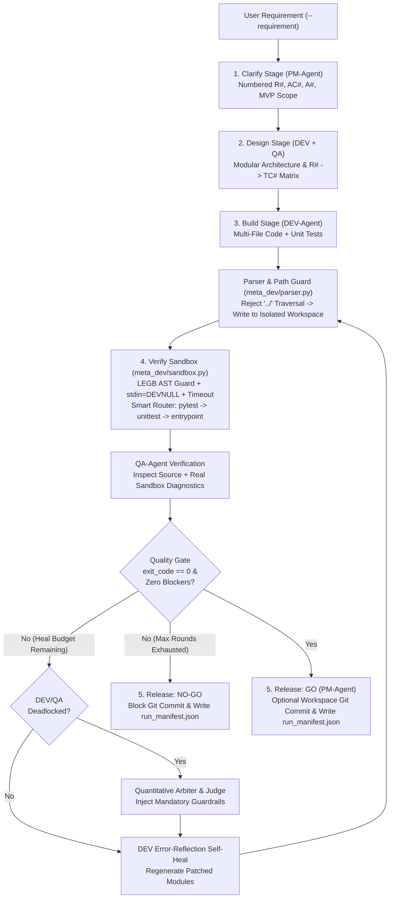

# Meta-Dev-Agent: Autonomous Multi-Agent Software Factory

[](https://www.python.org/)
[](./LICENSE)
[](#architecture)
[](#-zero-api-key-offline-demo---dry-run)

**Meta-Dev-Agent** 是一个基于 Python 构建的模块化全自动多智能体软件工场（Autonomous Multi-Agent Software Factory）。它通过协同编排 **PM（产品）**、**DEV（研发）**、**QA（测试）**、**Arbiter（冲突仲裁）** 与 **Judge（裁决解释）** 五类智能体，在隔离本地沙盒中闭环完成从“一句话自然语言需求”到**需求澄清、架构设计、多文件代码与单元测试生成、AST 静态护栏、沙盒错误反思自愈（Error-Reflection Self-Healing）、质量门禁裁决与自动化 Git 发布存档**的端到端交付流水线。

Repository: [https://github.com/Johnson-Durui/Meta-Dev-Agent](https://github.com/Johnson-Durui/Meta-Dev-Agent)

---

## ✨ 核心特性 (Key Highlights)

- **🧠 五阶段结构化多智能体编排 (`Clarify -> Design -> Build -> Verify -> Release`)**
  - 所有角色遵循统一协议信封（`TurnEnvelope`：显式需求/验收编号 `R#`/`AC#`、跨角色质询、结构化异议 `Objection` 与共识态 `CONSENSUS_STATUS`）。
- **⚖️ 量化冲突仲裁器与 Judge-Agent (`meta_dev/arbiter.py`)**
  - 当 DEV 与 QA 陷入多轮低新颖度拉锯（`deadlock_index >= 0.70`）或存在强分歧时，基于 10 维论点质量、反驳图谱击败衰减（Rebuttal Defeat Factor）、历史 Brier 可信度与后悔值最小化自动裁决（`FOLLOW_DEV` / `FOLLOW_QA` / `RUN_MINIMAL_EXPERIMENT` / `ESCALATE_TO_PM_AGENT`），并将败方高价值提醒吸收为强制护栏（Guardrails）。
- **🛡️ 词法作用域级 AST 静态分析与防越界提取器**
  - **AST `input()` 护栏**：遵循 Python LEGB 词法作用域规则，精准拦截阻塞型内置 `input()` / `builtins.input()` / `sys.stdin.readline()`，绝不误伤对象方法 `obj.input()` 或局部同名函数 `def input():`。
  - **路径穿越防御（`PathTraversalError`）**：多文件提取器对生成路径执行严格工作区边界校验，彻底阻断 `../`、盘符越界与绝对路径写入攻击。
- **🧪 智能本地沙盒与 Error-Reflection 自动自愈**
  - 自动探测项目测试并按优先级调度 `pytest` -> `unittest discover` -> 入口脚本；强制绑定 `stdin=subprocess.DEVNULL`、UTF-8 安全解码与毫秒级超时熔断。
  - 真实运行异常与断言栈自动封装为结构化诊断报告回灌 QA 与 DEV，驱动多轮闭环自愈。
- **🛑 强干预质量门禁（Quality Gates）与离线确定性演练（`--dry-run`）**
  - 拒绝任何测试失败、运行超时或残留 `Blocker` 异议状态下的强制放行（`NO-GO`）与 Git 提交。
  - 内置零密钥确定性后端 `MockLLMClient`，无需配置任何 API Key 即可在本地或 CI 完整跑通“首轮注入真实缺陷 -> `pytest` 捕获失败 -> QA 缺陷归因 -> DEV 自动修复 -> 次轮测试全绿 -> 生成 `run_manifest.json`”全流程！

---

## 🏗️ 系统架构 (Architecture)



---

## 📦 模块化目录结构 (`meta_dev/`)

原 4,000+ 行单文件实现已全面解耦为高内聚、强类型的 `meta_dev/` 软件包，同时在仓库根目录保留 `main.py` 与 `meta_dev_core.py` 兼容门面（Facade）：

```text
Meta-Dev-Agent/
├── meta_dev/
│   ├── __init__.py       # 公共包导出与版本声明
│   ├── models.py         # 强类型领域模型 (AgentRole, Stage, TurnEnvelope, SandboxReport, QualityGateVerdict 等)
│   ├── prompts.py        # COMMON_BASE 与 PM / DEV / QA / Arbiter / Judge 系统提示词及动态上下文拼装
│   ├── parser.py         # 结构化协议解析器、多文件代码块提取器与严格路径穿越拦截器 (PathTraversalError)
│   ├── sandbox.py        # LEGB 作用域感知 AST 静态护栏、进程隔离沙盒、智能测试路由与错误反思格式化
│   ├── arbiter.py        # 死锁检测指标、量化 Claim/Proposal 冲突仲裁算法、Judge 解释生成与质量门禁校验
│   ├── llm.py            # OpenAI 兼容 SDK 客户端（指数退避重试）与离线确定性后端 MockLLMClient
│   ├── git_ops.py        # 隔离工作区 Git 初始化、提交信息清洗与 run_manifest.json 持久化
│   ├── orchestrator.py   # 五阶段软件工场编排引擎 (SoftwareFactoryOrchestrator) 与自愈循环控制
│   └── cli.py            # 现代化命令行入口 (meta-dev)
├── tests/                # 全覆盖自动化单元测试与端到端自愈流水线测试套件
├── examples/             # 由工作流构建与沉淀的独立多文件展示项目
│   ├── ai_daily_briefing/
│   ├── meme_radar/
│   └── talking_plant/
├── main.py               # 向后兼容 CLI 与 API 门面
├── meta_dev_core.py      # 向后兼容核心 API 门面
├── pyproject.toml        # 标准现代 Python 打包、脚本入口与 Ruff/Pytest 配置
└── requirements.txt      # 轻量级核心运行依赖
```

---

## 🚀 快速启动 (Quick Start)

### 1. 克隆与安装

```bash
git clone https://github.com/Johnson-Durui/Meta-Dev-Agent.git
cd Meta-Dev-Agent

pip install -r requirements.txt
# 可选：以可编辑模式注册 `meta-dev` 全局命令
pip install -e .
```

### 2. 零 API Key 离线全链路自愈演示 (`--dry-run`)

无需任何外部网络或密钥，即可体验完整的 5 阶段多智能体软件工场与真实沙盒自愈闭环：

```bash
python main.py \
  --requirement "Build a prioritized task scheduling package with CLI and pytest unit tests" \
  --workspace ./workspaces/demo_run \
  --dry-run \
  --auto-git \
  --non-interactive
```

执行过程将真实在 `./workspaces/demo_run` 中演示：
1. **Clarify & Design**：PM 拆解 `R1-R4`/`AC1-AC4`，DEV 与 QA 对齐多文件架构与测试矩阵。
2. **Build (Round 1)**：生成 `task_forge/` 多文件包与 `tests/test_task_forge.py`（首轮刻意包含优先级升序反转 Bug）。
3. **Verify & Self-Heal**：沙盒自动运行 `pytest` 捕获真实断言失败 -> QA 提交 `Blocker` 缺陷 `B1` -> DEV 基于错误反思自动修复排序逻辑 -> 次轮 `pytest` 全绿通过。
4. **Release**：通过质量门禁裁决（`GO`），在独立工作区内自动完成 `git init` + `git commit`，并输出完整审计清单 `./workspaces/demo_run/run_manifest.json`。

### 3. 连接真实大模型 API 运行

复制 `.env.example` 为 `.env` 或设置环境变量（支持官方 OpenAI 及任意 OpenAI 兼容网关，如 DeepSeek、OpenRouter、OneAPI、vLLM 等）：

```bash
cp .env.example .env
export OPENAI_API_KEY="sk-your-api-key"
export OPENAI_BASE_URL="https://api.openai.com/v1"
export META_DEV_MODEL="gpt-4o"

python main.py \
  --requirement "实现一个支持停用词过滤、UTF-8 多语种词频统计与 JSON 导出的 Python 包，并附带完整 pytest 单元测试" \
  --workspace ./workspaces/word_freq_app \
  --max-heal-rounds 3 \
  --auto-git \
  --non-interactive
```

---

## ⌨️ CLI 参数参考 (CLI Reference)

| 参数 | 说明 | 默认值 |
| :--- | :--- | :--- |
| `-r`, `--requirement` | 输入给 5 阶段软件工场的自然语言开发需求 | — |
| `-w`, `--workspace` | 生成代码、测试、隔离 Git 仓库与 `run_manifest.json` 的目标工作区目录 | `./workspaces/factory-<UTC>` |
| `-m`, `--model` | 调用的模型名称（读取 `META_DEV_MODEL` / `OPENAI_MODEL`） | `gpt-4o` |
| `--base-url` | OpenAI 兼容接口地址（读取 `OPENAI_BASE_URL`） | `https://api.openai.com/v1` |
| `--max-heal-rounds` | QA -> DEV 错误反思自愈循环的最大重试轮数 | `3` |
| `--run-timeout` | 单次沙盒测试或入口脚本执行的超时阈值（秒） | `15` |
| `--dry-run` | 启用内置确定性离线后端 `MockLLMClient`（零 API Key 端到端演练） | `False` |
| `--auto-git` | 质量门禁通过（`GO`）后在目标工作区内自动初始化 Git 并提交产物 | `False` |
| `--non-interactive` | 禁用一切终端交互提示，开启严格 AST 阻塞输入静态拦截 | `False` |
| `--arbitrate-file` | 读取仲裁输入 JSON 并输出量化 DEV/QA 冲突裁决结果 | — |
| `--explain-arbitration` | 配合 `--arbitrate-file` 生成 Judge-Agent 可读工程解释 | `False` |
| `--print-arbitration-template` | 打印标准 DEV/QA 仲裁输入模板 JSON | `False` |

---

## 🔒 安全与沙盒护栏保证 (Security & Sandbox Guarantees)

1. **工作区边界强隔离（Workspace Containment）**：`meta_dev.parser.validate_safe_relative_path` 拒绝一切 `..` 路径跳转、盘符前缀、控制字符与绝对路径，确保大模型生成的文件严格落盘在 `--workspace` 目录内部。
2. **LEGB 静态阻塞拦截（AST Input Guard）**：`meta_dev.sandbox.analyze_python_ast` 基于完整语法树与词法作用域链分析阻塞调用，并标记 `eval()`、`exec()`、`os.system()`、`subprocess(..., shell=True)` 等高危调用告警。
3. **无阻塞子进程执行（Non-Blocking Process Isolation）**：沙盒执行器强制设置 `stdin=subprocess.DEVNULL` 与严格 `timeout` 熔断，杜绝死循环或等待终端输入拖挂自动化流水线。
4. **不可绕过的质量门禁（Deterministic Quality Gates）**：`meta_dev.arbiter.verify_quality_gate` 在测试退出码非零、执行超时或存在未关闭 QA `Blocker` 异议时硬性阻断 `Release` 与自动 Git 存档。

---

## 🖼️ 展示案例画廊 (`examples/`)

[`examples/`](./examples/README.md) 目录收录了多类型完整项目案例，每个案例均拥有独立依赖声明，与核心编排引擎完全解耦：

- **[`examples/ai_daily_briefing/`](./examples/ai_daily_briefing/)**：自动化 AI 晨报聚合器（RSS + X 动态追踪 + 中文摘要归档 + 响应式本地阅读器）。
- **[`examples/meme_radar/`](./examples/meme_radar/)**：基于 FastAPI、`httpx` 与 DEX Screener 实时行情的链上热门代币信号雷达工作台（含 Docker / Render / Railway 部署配置）。
- **[`examples/talking_plant/`](./examples/talking_plant/)**：桌面语音情绪交互植物机器人（结合 `faster-whisper` 实时语音识别、`sentence-transformers` 情绪/意图分类、TTS 与双舵机 + NeoPixel 灯环 Arduino 固件）。

---

## 🧪 开发测试与代码检查 (Testing & Linting)

```bash
# 运行完整自动化测试套件（AST 护栏、路径防越界、沙盒超时、冲突仲裁与端到端自愈闭环）
python -m pytest -v

# 运行 Ruff 静态代码质量与规范检查
python -m ruff check meta_dev tests main.py meta_dev_core.py
```

---

## 📄 开源协议 (License)

本项目基于 [MIT License](./LICENSE) 开源。
